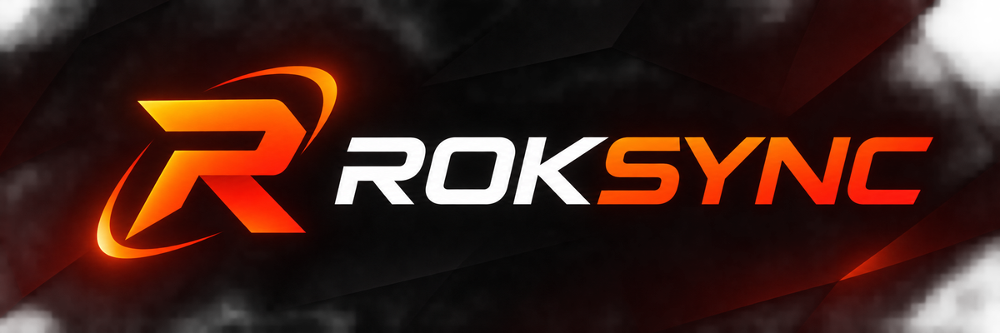
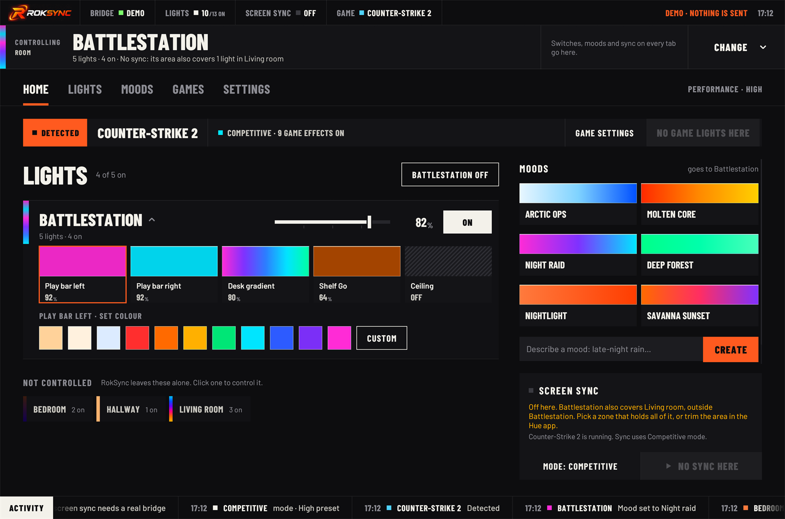
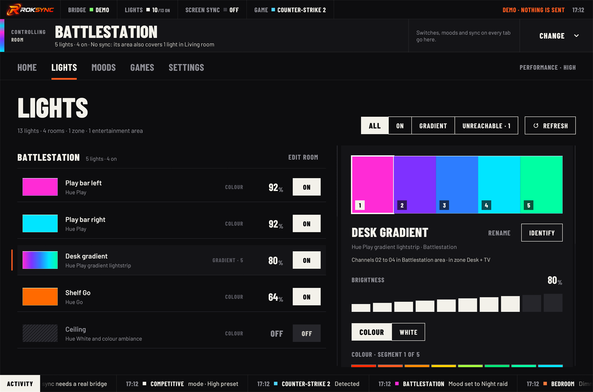
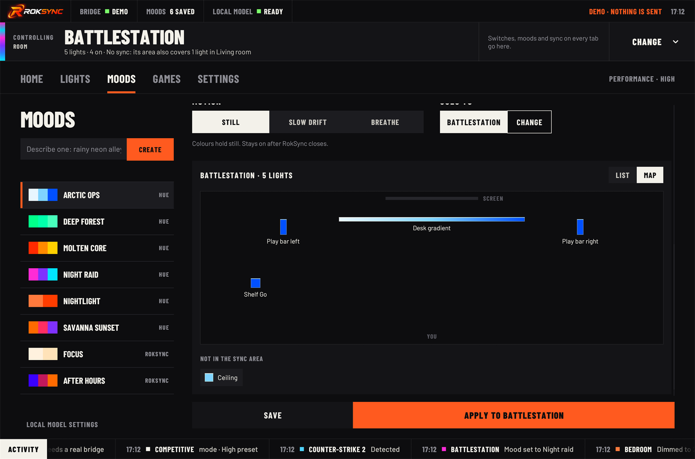
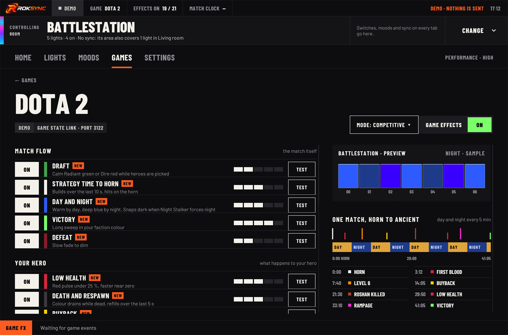
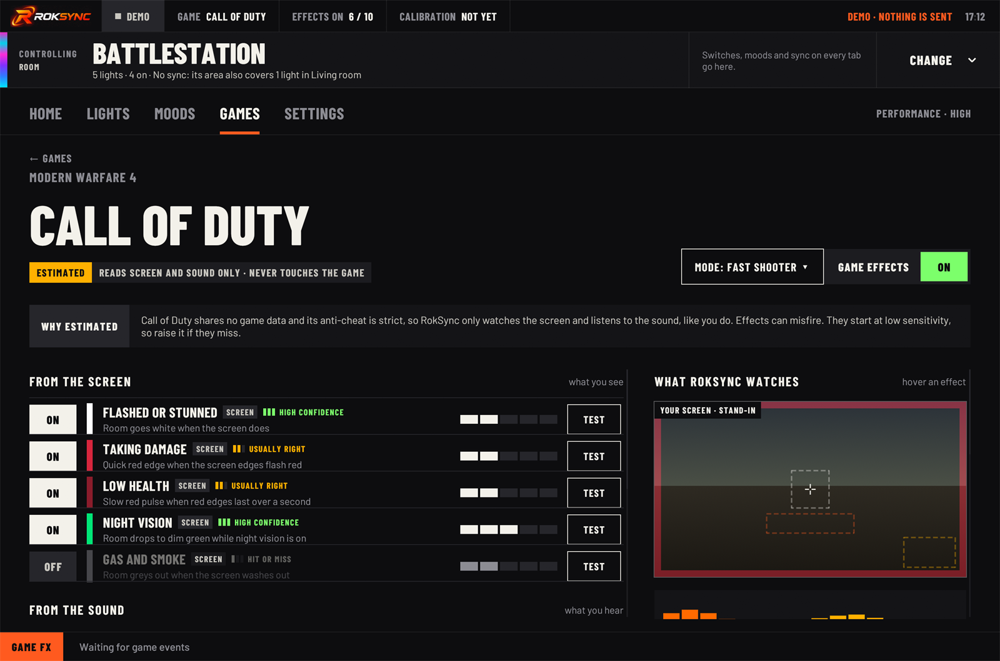

<p align="center">
  
</p>

<h3 align="center">Your game. Your lights. In sync.</h3>

<p align="center">
  Gaming-focused ambient lighting for Philips Hue, built in Rust for Windows.
</p>

<p align="center">
  
  
  
  <a href="LICENSE"></a>
</p>

<p align="center">
  
</p>

---

## What it does

|  |  |
|---|---|
| **Screen sync** | Streams the colours on your screen to a Hue entertainment area. Black bars are cropped out, and you can follow a single window. |
| **Game effects** | Counter-Strike 2 and Dota 2 send live match data. Your room reacts to flashes, damage, kills, the bomb, Roshan and the horn. |
| **Call of Duty** | Effects come from what's on screen and what you hear. RokSync never touches the game. |
| **Game modes** | Finds your Steam library and switches mode when a game launches: Competitive, Fast Shooter, Cinematic, RPG & Worlds, Horror, Racing or Cozy. |
| **Moods** | Type "late-night rain" and get a palette placed across your actual lights. |
| **Lights** | Rooms, zones, gradient segments and white temperature, without opening the Hue app. |

---

## Lights

Every light in the house on one page. Gradient strips are split into segments you can colour one at a time. The map shows where each light sits in your entertainment area.

<p align="center">
  
</p>

## Moods

Describe a feeling and RokSync builds a palette for the room. Strips get blends, bulbs get accents, and one focus light carries the key colour. Moods can sit still, drift slowly or breathe.

Quick mode matches words to colours instantly. For better results, download a small language model from Settings. It runs on your own PC.

<p align="center">
  
</p>

## Games

<table>
  <tr>
    <td width="50%"></td>
    <td width="50%"></td>
  </tr>
  <tr>
    <td valign="top">
      <b>Dota 2</b><br>
      21 effects across the draft, the horn, day and night, your hero, kill streaks, Roshan and the Ancient. RokSync writes the game state config for you. Add <code>-gamestateintegration</code> to Dota's launch options and restart the game.
    </td>
    <td valign="top">
      <b>Call of Duty</b><br>
      Flashes, damage, low health, night vision, gas, explosions, firefights and hit markers, estimated from the picture and your PC's sound. A short calibration teaches RokSync your HUD. Every effect has a sensitivity slider.
    </td>
  </tr>
</table>

**Counter-Strike 2** works the same way as Dota 2. The room whites out for exactly as long as a flashbang blinds you, beats red at low HP, flickers in a molly and beeps with the bomb.

Every effect has an on/off switch, a strength setting and a TEST button. Turn on **Reduce flashing** to swap strobes for soft fades.

---

## Getting started

You need:

- Windows 10 or 11
- A Philips Hue Bridge (the square v2 bridge)
- An entertainment area set up in the Hue app, for screen sync and game effects

```powershell
git clone https://github.com/thepedroferrari/RokSync.git
cd RokSync
cargo build --release
.\target\release\roksync.exe
```

On first launch RokSync finds your bridge and asks you to press its link button. That's the only pairing step.

Try it without a bridge:

```powershell
.\target\release\roksync.exe demo
```

### Keys

| Key | Action |
|---|---|
| `1` – `5` | Jump to a tab |
| `Q` / `E` | Previous / next tab |
| `F` | Start or stop screen sync |
| `Ctrl` `Alt` `L` | Stop everything, even mid-game |

### Command line

```text
roksync discover                                      find bridges on the network
roksync pair                                          pair with a bridge
roksync list                                          rooms, zones, lights, areas, scenes
roksync set "Desk gradient" "#ff00aa"                 set a light, room or zone
roksync gradient "Desk gradient" "#ff0000" "#0000ff"  set gradient points
roksync power "Battlestation" off                     turn things on or off
roksync mood "rainy neon night" --apply               describe a mood, light the room
roksync cs2                                           Counter-Strike 2 integration
```

Run `roksync --help` for every option.

---

## Built with

Rust · [egui](https://github.com/emilk/egui) · Hue CLIP v2 and Entertainment streaming over DTLS · DXGI desktop duplication · WASAPI loopback · [llama.cpp](https://github.com/ggml-org/llama.cpp) for moods · [Barlow](https://github.com/jpt/barlow) by Jeremy Tribby

```text
app/                 the desktop app and CLI
crates/lumen-hue     bridge discovery, pairing, control and streaming
crates/lumen-engine  looks, motion and effect overlays
crates/lumen-screen  screen capture and colour sampling
crates/lumen-cs2     Counter-Strike 2 game state
crates/lumen-dota    Dota 2 game state
crates/lumen-cod     Call of Duty screen and sound detectors
crates/lumen-mood    mood to light plan
```

RokSync isn't affiliated with Signify, Philips Hue, Valve or Activision.

## Licence

[MIT](LICENSE). Barlow is under the SIL Open Font License.
